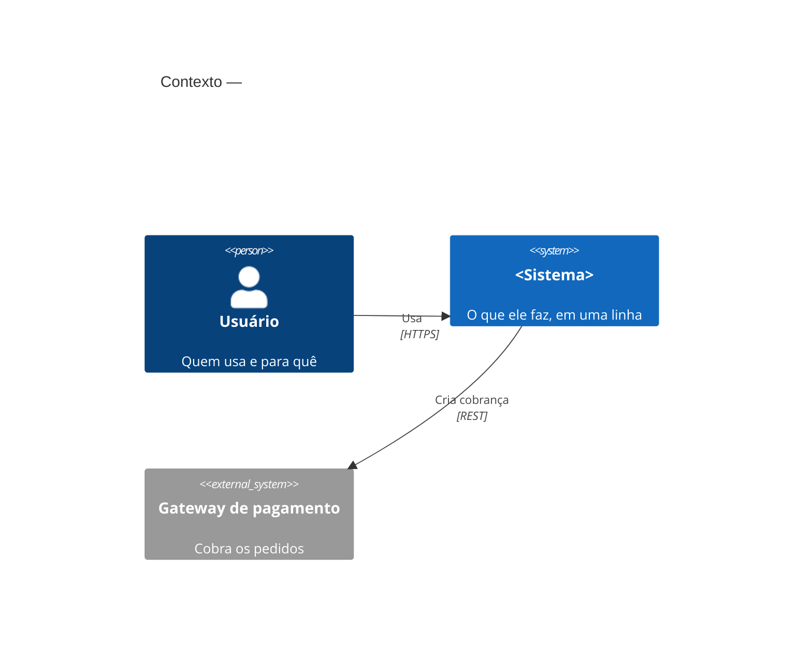
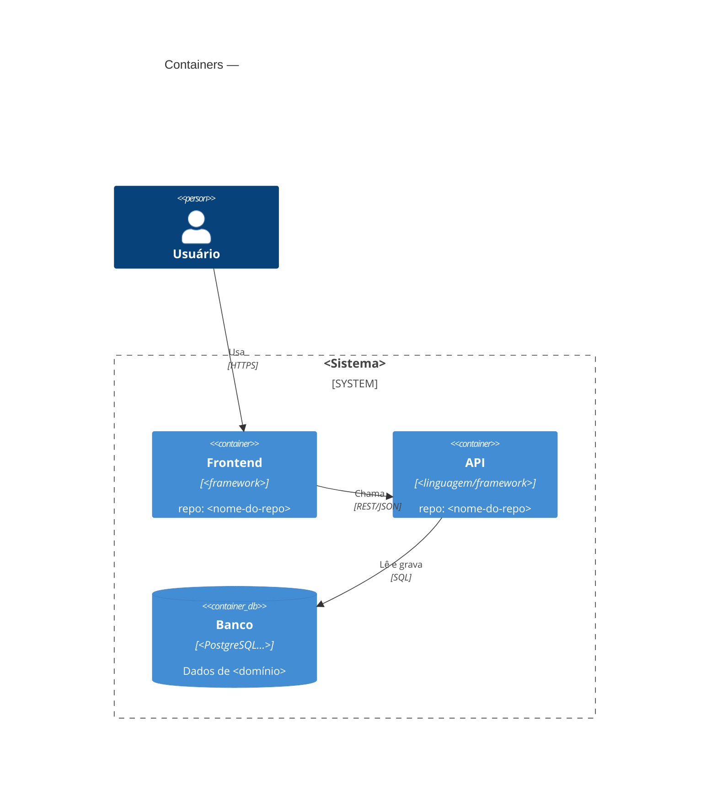
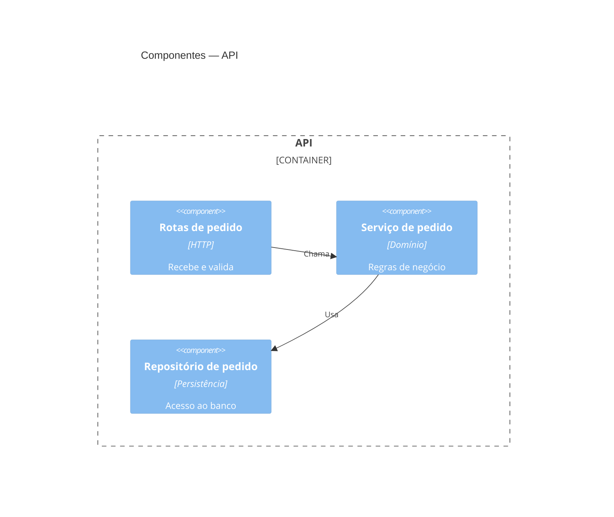

# Padrões C4 e ADR para desenho de software

> Referência de **como desenhar e registrar arquitetura** no Liz: os quatro níveis do C4 em Mermaid, onde
> cada desenho mora, quando uma decisão vira ADR e o modelo de ADR. Quem lê: `@software-architect`,
> `/engineer-start` (seção Arquitetura) e `/docs-build-tech-docs`.

Vale para qualquer stack. O exemplo pode ser Node, Python, Java ou Go: o C4 descreve **o que roda e
quem fala com quem**, não a linguagem.

---

## 1. Os quatro níveis do C4

| Nível | Pergunta que responde | Quando desenhar |
|---|---|---|
| **1. Contexto** | Quem usa o sistema e com que sistemas externos ele fala? | Sempre, uma vez por produto |
| **2. Containers** | Que peças rodam separadas (app, API, worker, banco, fila) e como conversam? | Sempre; é o desenho mais útil |
| **3. Componentes** | Como um container se divide por dentro (módulos, camadas)? | Só no container que a feature mexe |
| **4. Código** | Classes e funções | Quase nunca; o código já é esse desenho |

**Workspace com vários repos.** Em geral cada repo do `.agents/workspace.yaml` é um container (ou um
grupo deles). Liste os repos com `bash .agents/utils/workspace/ws.sh list` e use o `role` de cada um
(`backend`, `frontend`, `mcp`...) como ponto de partida do nível 2. Um container que não é repo do
workspace (banco, fila, serviço de terceiros) entra com o nome do produto que roda nele.

### 1.1. Contexto (nível 1)



### 1.2. Containers (nível 2)



### 1.3. Componentes (nível 3)



**Antes e depois.** No `architecture.md` de uma feature, desenhe o nível que muda **duas vezes**: como é
hoje e como fica. Marque no "depois" o que é novo (`"[novo]"` na descrição) para o revisor bater o olho.

### 1.4. Quando o C4 não basta

| Precisa mostrar | Diagrama Mermaid |
|---|---|
| A ordem das chamadas num fluxo (login, checkout) | `sequenceDiagram` |
| Os estados de uma entidade (pedido: criado → pago → enviado) | `stateDiagram-v2` |
| O modelo de dados | `erDiagram` |
| Onde cada coisa roda (servidores, nuvem) | `flowchart` com `subgraph` por ambiente |

### 1.5. Regras do desenho

- Mermaid, dentro do próprio `.md`, para renderizar no GitHub e no editor. Sem PlantUML nem imagem solta.
- Cada caixa diz **o que faz**, não só o nome. Cada seta diz **o quê** e **como** (`"Cria cobrança", "REST"`).
- No máximo ~15 caixas por desenho. Passou disso, divida por nível ou por fluxo.
- O desenho bate com o código. Se a feature mudar o desenho, o `architecture.md` muda junto.

---

## 2. Onde cada coisa mora

| O quê | Onde |
|---|---|
| Arquitetura do produto (C4 níveis 1 e 2) | `docs/technical-context/01-core/architecture.md` (gerado por `/docs-build-tech-docs`) |
| Decisões do produto (ADRs) | `docs/technical-context/01-core/adr/<NNN>-<decisao>.md` |
| Desenho de uma feature (antes/depois) | `.agents/sessions/<feature-slug>/architecture.md` (gerado por `/engineer-start`) |
| Resposta a uma dúvida antes de desenhar | `.agents/sessions/<feature-slug>/spike-<slug>.md` (gerado por `/engineer-spike`) |

A pasta `docs/technical-context/` pode ter outro nome: ela vem de
`bash .agents/utils/scope/resolve-context-dir.sh technical`.

Ao fechar uma feature, a decisão que vale para o produto inteiro **sobe** do `architecture.md` da
sessão para um ADR em `01-core/adr/`. A sessão é temporária; o ADR fica.

---

## 3. ADR — quando escrever

Escreva um ADR quando a decisão:

- é **cara de desfazer** (banco, linguagem, framework, contrato de API pública, formato de dados);
- **afeta mais de um repo** do workspace;
- escolhe entre **alternativas razoáveis** e o motivo não aparece no código;
- **contraria** um padrão que o projeto já seguia.

Não escreva ADR para escolha local e reversível (nome de variável, biblioteca de utilidade, refator
interno). Isso vai no `architecture.md` da sessão ou no commit.

## 4. Modelo de ADR

Numeração sequencial de três dígitos, nome em kebab-case: `007-fila-para-notificacoes.md`.

```markdown
# ADR-<NNN>: <decisão em poucas palavras>

- **Status:** proposto | aceito | substituído por ADR-<NNN> | abandonado
- **Data:** AAAA-MM-DD
- **Repos afetados:** <nomes do workspace.yaml>
- **Origem:** <tarefa, sessão ou spike que levou à decisão>

## Contexto
<O problema e as forças em jogo: requisitos, restrições, prazo, o que já existe.>

## Decisão
<O que foi decidido, na voz ativa: "Usamos X para Y".>

## Alternativas consideradas
- **<Alternativa A>** — prós: ... / contras: ... / por que não: ...
- **<Alternativa B>** — prós: ... / contras: ... / por que não: ...

## Consequências
- **Boas:** <o que fica mais fácil>
- **Ruins:** <o custo que aceitamos>
- **A vigiar:** <sinal que faria rever esta decisão>
```

ADR aceito não se edita: se a decisão mudar, escreva um novo e marque o antigo como "substituído por".

---

## 5. Checklist do desenho

- [ ] Contexto (nível 1) e Containers (nível 2) existem e renderizam
- [ ] Cada repo do workspace aparece no nível 2 (ou está explicado por que não)
- [ ] Setas com o quê e o como
- [ ] O desenho da feature mostra antes e depois
- [ ] Decisões caras de desfazer viraram ADR, com alternativas
- [ ] Nada no desenho contradiz o código atual

---

*Adaptado do Onion (Marcio Carvalho), CC BY-NC 4.0. Ver `NOTICE.md`.*
