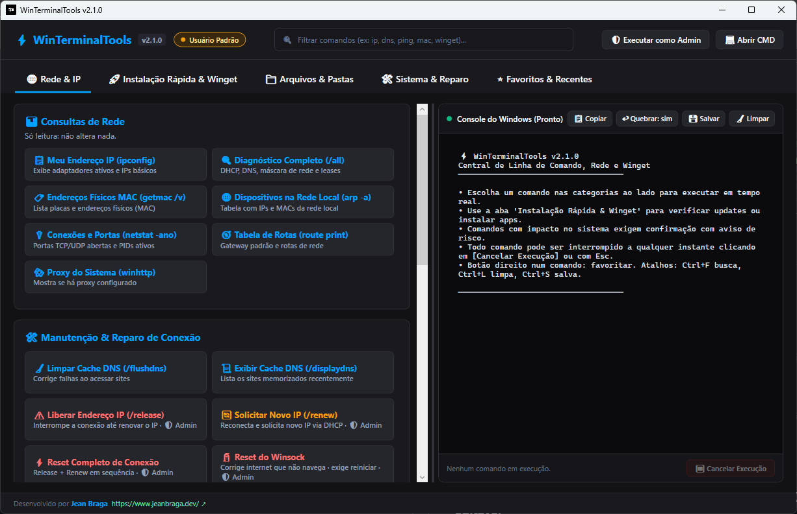
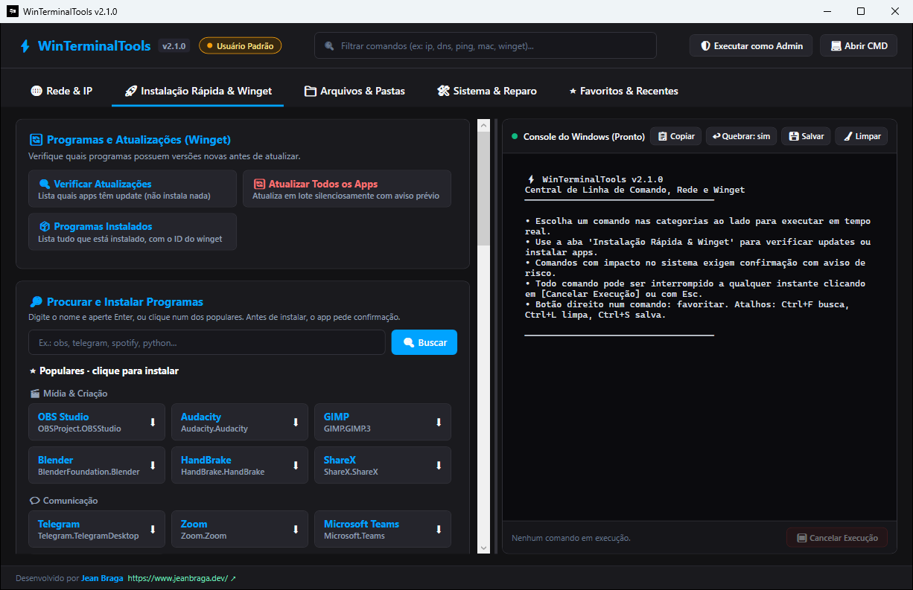
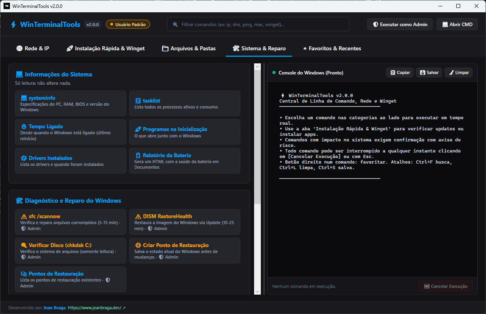
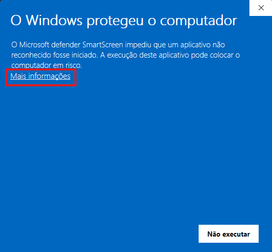
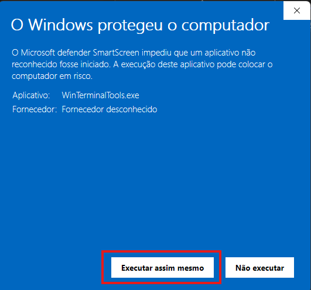

# WinTerminalTools v2.0

Ferramenta com interface gráfica (WPF, .NET 10) para Windows 64 bits que reúne os comandos úteis do CMD e do PowerShell em botões com descrição. A saída aparece em tempo real num console embutido, qualquer execução pode ser cancelada e os comandos que mexem no sistema pedem confirmação com aviso de risco.

<p align="center">
  
</p>

## O que ele faz

| Aba | Comandos |
|---|---|
| 🌐 **Rede & IP** | ipconfig (/all, /flushdns, /displaydns, /release, /renew), getmac, arp, netstat, rotas, proxy, ping, tracert, nslookup, teste de porta, reset de Winsock e TCP/IP, reparo completo da rede, Wi-Fi atual, redes salvas e senha de uma rede salva |
| 🚀 **Instalação Rápida & Winget** | verificar e aplicar atualizações, programas instalados, instalar/atualizar/desinstalar por ID, busca no repositório, exportar e importar a lista de programas, instalação em lote pós-formatação (lista editável) |
| 📁 **Arquivos & Pastas** | criar pasta, listar conteúdo (dir), abrir no Explorer, espaço em disco, saúde dos discos, limpar temporários, esvaziar lixeira |
| 🛠️ **Sistema & Reparo** | systeminfo, tasklist, tempo ligado, programas na inicialização, drivers, relatório de bateria, sfc, DISM, chkdsk, pontos de restauração, desligar/reiniciar programado, hibernar, bloquear, planos de energia |
| ⭐ **Favoritos & Recentes** | seus comandos favoritos (botão direito em qualquer comando) e o histórico com "Repetir" |

Outros detalhes:

- **Cores pelo risco:** azul só lê informações, laranja demora ou pesa no PC, vermelho altera o sistema. Os comandos marcados com 🛡️ pedem Administrador, e o app avisa **antes** de executar (oferece reabrir como admin).
- **Busca** (Ctrl+F) por nome, descrição ou comando, sem diferenciar acentos, abrindo a aba onde encontrou.
- **Console:** copiar, salvar em .txt (Ctrl+S), limpar (Ctrl+L), cancelar (Esc). Atalhos Ctrl+1 a Ctrl+5 trocam de aba.

<p align="center">
  
  
</p>

## Instalação

**Jeito mais simples:** [⬇️ baixar o WinTerminalTools.exe](https://github.com/jeanr0cha/WinTerminalTools/releases/latest/download/WinTerminalTools.exe) (~62 MB, sempre a versão mais recente). É um executável único: funciona em qualquer Windows 10/11 64 bits, **sem instalar nada**. É só abrir.

Na aba [Releases](https://github.com/jeanr0cha/WinTerminalTools/releases) também há os ZIPs:
- `WinTerminalTools-vX.Y.Z-win-x64-completo.zip` (~57 MB): o mesmo executável completo, compactado.
- `WinTerminalTools-vX.Y.Z-win-x64.zip` (menos de 1 MB): menor, mas exige o [.NET 10 Desktop Runtime](https://dotnet.microsoft.com/download/dotnet/10.0).

Para os comandos de reparo, use o botão **🛡️ Executar como Admin** dentro do app.

O winget vem no Windows 10/11 atualizado (pacote "Instalador de Aplicativo" da Microsoft Store). Se ele não estiver instalado, o app avisa e mostra onde instalar.

<h2 align="center">⚠️ AVISO ⚠️</h2>

### Como este é um projeto pessoal, o executável não possui uma assinatura de código digital paga. É normal que o Windows exiba um aviso de segurança ao executá-lo pela primeira vez; geralmente o aviso não aparece nas próximas vezes.

<p align="center">
  <strong>Ao ver a tela "O Windows protegeu o computador", clique no link de texto "Mais informações".</strong>
</p>

<p align="center">
  
</p>

<p align="center">
  <strong>Em seguida, um novo botão aparecerá. Clique em "Executar mesmo assim".</strong>
</p>

<p align="center">
  
</p>

## Arquivos que o app cria

Ficam em `%APPDATA%\WinTerminalTools\`. Apagar a pasta volta tudo ao padrão.

- `settings.json`: favoritos e histórico recente.
- `apps.json`: só existe se você clicar em **✏️ Editar Lista** na instalação rápida. Cada grupo tem `title` e uma lista de `apps` com `id` (ID do winget), `name` e `checked` (vem marcado ou não). Depois de salvar, clique em **🔄 Recarregar**.

## Sobre o Projeto

Resolvi iniciar o desenvolvimento deste projeto com o intuito de aprender mais sobre as ferramentas possíveis a utilizar no CMD, além das convencionais como ipconfig. Também vi nisto uma maneira de aperfeiçoar meu aprendizado em C# e .NET.

O WinTerminalTools, o nome vem de uma União de Ferramentas de terminal do Windows, é uma ferramenta de código aberto construída e idealizada por mim em C# e .NET 10, utilizando WPF para a interface (a v1.0 usava a biblioteca Terminal.Gui, em modo texto). O objetivo é centralizar diversos comandos úteis do Windows (como ipconfig, ping, winget, etc.) em um único local de fácil acesso e com instruções sobre o que cada comando executa. Isso evita que o usuário, ao precisar rodar um comando menos conhecido, tenha que pesquisar externamente sua função, pois o próprio programa já fornece uma descrição.

A ideia de usar o C# é pela integração com o Windows, e a interface busca ser leve, "limpa e simples".

## Desenvolvimento

```
dotnet build WinTerminalTools.sln
dotnet test tests/WinTerminalTools.Tests
dotnet run --project WinTerminalTools.csproj
```

- `Core/CommandCatalog.cs`: monta cada comando (executável + argumentos) e guarda o catálogo da interface (`Sections` + `Definitions`). **Adicionar um comando novo é acrescentar uma entrada ali**: a tela monta o botão, a cor, o aviso de admin, a confirmação e a busca.
- `Core/CommandExecutor.cs`: executa processos **sem shell** (`ArgumentList`), com cancelamento da árvore de processos.
- `Core/InputValidator.cs`: valida host/IP, porta, ID do winget, termo de busca, nome de rede Wi-Fi, minutos e caminho de pasta digitados pelo usuário.
- `Core/QuickInstallCatalog.cs` e `Core/UserSettings.cs`: lista da instalação rápida e preferências (favoritos e histórico).
- `tests/`: testes xUnit. Só executam comandos inofensivos (echo, ping 127.0.0.1, leitura); os que alteram o sistema são testados apenas na montagem dos argumentos.
- **Release:** `git tag vX.Y.Z && git push origin vX.Y.Z` dispara `.github/workflows/release.yml`, que roda os testes e publica os dois ZIPs e o `WinTerminalTools.exe` solto. As notas ficam em `docs/releases/`.

## Contribuindo

1. Abra uma issue descrevendo a mudança desejada.
2. Faça um fork e um branch de feature.
3. Envie um pull request com uma descrição clara.

## Licença

Este projeto é licenciado sob a MIT License — veja o arquivo `LICENSE` na raiz para o texto completo.
